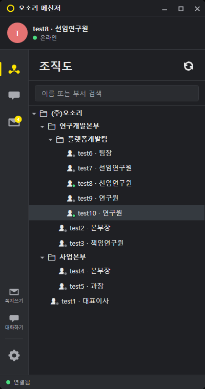
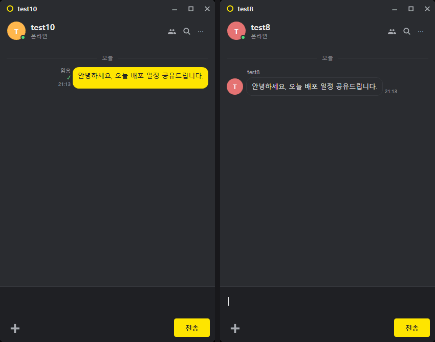
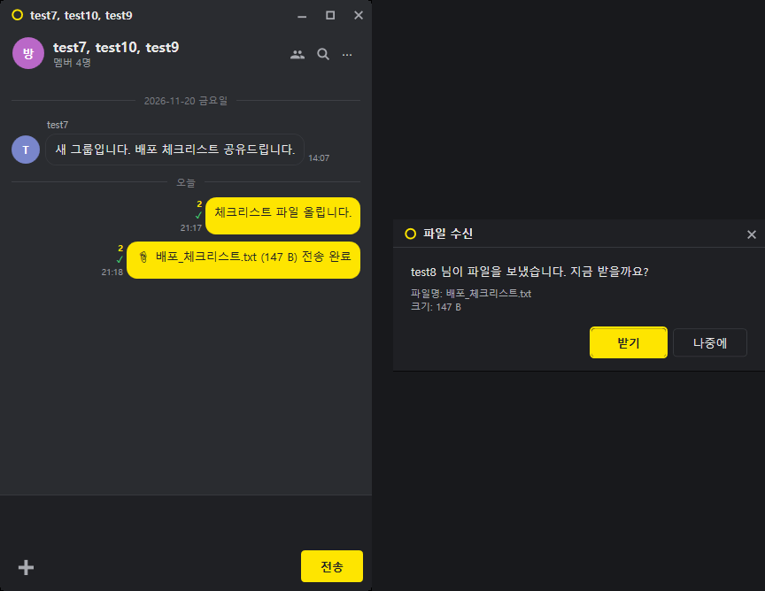
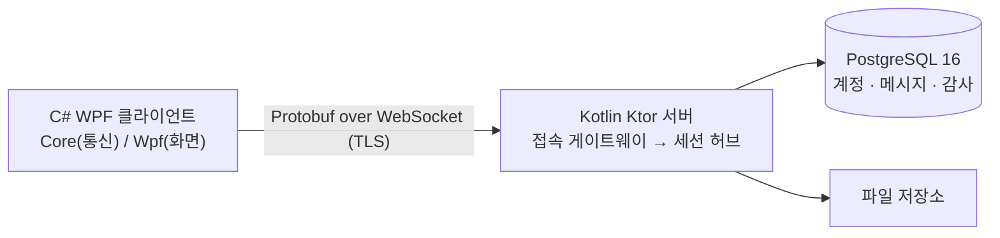

# 오소리 메신저 (Osori Messenger)

사내 메신저를 서버, 클라이언트, 통신 규약까지 처음부터 설계하고 구현한 개인 프로젝트입니다.
서버는 Kotlin(Ktor), 클라이언트는 C#(.NET 8, WPF), 통신은 WebSocket 위의 Protobuf, 저장소는 PostgreSQL입니다.



| 대화 주고받기 | 그룹 방 파일 전송 |
|---|---|
|  |  |

## 주요 기능

- 1:1·그룹 대화: 방 만들기, 초대, 나가기, 이름 변경, 대화 기록, 연속 메시지 묶기
- 읽음 표시: 내가 보낸 메시지 옆에 안 읽은 인원, 모두 읽으면 "읽음"
- 파일 전송: 1:1·그룹 방, 방 멤버 전원에게 알림, 대화 기록에서 나중에 받기
- 쪽지: 여러 명에게 보내기(받는 사람 칩), 첨부, 답장·전체회신·전달
- 조직도: 부서 트리, 접속 표시, 이름 검색, 여러 명 골라 대화·쪽지
- 대화 검색, 중복 로그인 안내, 자동 재접속, 오프라인 메시지 전달

## 구조



## 설계 결정

| 결정 | 이유 |
|---|---|
| Protobuf 봉투(Envelope) 하나로 모든 메시지 전송 | 기능이 늘어도 규약은 하나. 스키마에서 서버·클라이언트 코드를 함께 생성해 양쪽 형식이 어긋나지 않음 |
| PostgreSQL 하나, 영역별 테이블 분리 | 여러 DBMS를 동시에 지원하는 대신 하나로 정하고, 메시지와 감사 기록의 보관 정책을 따로 적용 |
| 비밀번호 Argon2id, 통신 TLS | 로그인 허용 계정 검사와 요청 횟수 제한을 서버 공통 단계에서 처리 |
| 재접속 간격 증가, 클라이언트 메시지 ID | 끊겨도 같은 메시지가 두 번 저장되지 않음 |
| 클라이언트를 Core / Wpf 로 분리 | 통신·상태 로직을 화면 없이 단위 테스트 |

## 품질

- 자동 테스트: 서버 258개(DB·WebSocket 통합 테스트 포함), 클라이언트 127개
- GitHub Actions CI: 서버(PostgreSQL 컨테이너 포함)·클라이언트 빌드와 테스트
- 운영 구성: Docker Compose, DB 백업, 로그 회전, 설치 프로그램(Inno Setup)

## 실행 방법

필요한 것: JDK 17, .NET 8 SDK, Docker(또는 PostgreSQL 16)

```powershell
# 1) DB (schema.sql 이 첫 기동 때 자동 적용됨)
docker compose -f docker/docker-compose.yml up -d

# 2) 개발용 계정 만들기 (admin, test1~test10 / 비밀번호 1234)
cd server
.\gradlew.bat seedAllowedAccounts

# 3) 서버 (클라이언트 기본 포트 7071)
$env:OSORI_PORT = "7071"
.\gradlew.bat run

# 4) 클라이언트 (새 터미널)
cd ..\client-csharp\src\OsoriClient.Wpf
dotnet run
```

테스트:

```powershell
cd server; .\gradlew.bat test
cd ..\client-csharp; dotnet test src\OsoriClient.Core.Tests
```

> 개발용 계정과 비밀번호(1234)는 로컬 확인용입니다. 운영 환경에서는 쓰지 않습니다.
> 이미 만든 DB에 새 버전을 올릴 때는 `server/src/main/resources/db/migrations/` 의 파일을 순서대로 적용합니다.

## 폴더

| 경로 | 내용 |
|---|---|
| `server/` | Kotlin Ktor 서버, DB 스키마·마이그레이션, 테스트 |
| `client-csharp/` | WPF 클라이언트(Core·Wpf·테스트) |
| `proto/` | 통신 규약(messenger.proto) |
| `docker/` | 개발·운영용 Compose, TLS 가이드 |
| `installer/` | 클라이언트 설치 프로그램 |
| `PROTOCOL.md` | 메시지 종류와 흐름 설명 |

## 라이선스

MIT
